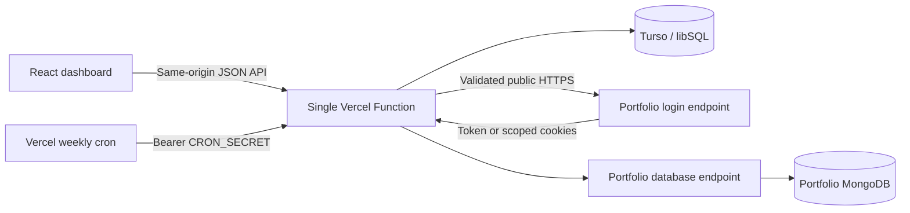

# Architecture

## Components

Nudge has a static React frontend, one TypeScript API function and one relational database. The same server handler is used locally and on Vercel.

The MongoDB operation belongs to the portfolio application. Nudge does not connect to Atlas directly or verify the application's database query internally.

## Source map

| Source                                           | Responsibility                                                          |
| ------------------------------------------------ | ----------------------------------------------------------------------- |
| [src/App.tsx](../../src/App.tsx)                 | Login, dashboard, history, actions and contextual tab title             |
| [src/ProjectForm.tsx](../../src/ProjectForm.tsx) | Configuration editor and unsaved connection tests                       |
| [src/api.ts](../../src/api.ts)                   | Same-origin fetch client and API error handling                         |
| [src/styles.css](../../src/styles.css)           | Responsive skeuomorphic styling                                         |
| [api/index.ts](../../api/index.ts)               | Vercel Web Request/Response entry point                                 |
| [server/app.ts](../../server/app.ts)             | Routing, body limits, authorization boundary and sanitized responses    |
| [server/auth.ts](../../server/auth.ts)           | Admin login, persisted sessions, origin checks and rate limiting        |
| [server/projects.ts](../../server/projects.ts)   | Configuration validation, encrypted storage and public projections      |
| [server/http.ts](../../server/http.ts)           | DNS/IP validation, pinned HTTPS and response limits                     |
| [server/runner.ts](../../server/runner.ts)       | Authentication followed by the keep-alive request                       |
| [server/checks.ts](../../server/checks.ts)       | Execution lease, worker pool, history, cron deduplication and retention |
| [server/crypto.ts](../../server/crypto.ts)       | AES-GCM, token digests and timing-safe comparison                       |
| [server/db.ts](../../server/db.ts)               | Reused libSQL client and parameterized queries                          |
| [server/config.ts](../../server/config.ts)       | Required settings, trusted origins and operating limits                 |

## Browser request flow

The browser uses relative `/api/...` URLs and same-origin cookies. It does not receive database tokens, the encryption key, the admin hash or saved portfolio credentials. There is no localStorage-based authentication and no frontend secret configuration.

On startup, the client checks `/api/auth/session`. An authenticated browser fetches projects and history in parallel. Writes use JSON, pass origin validation and then require a session, except for the login endpoint. The cron route is handled separately using its bearer secret.

The API returns JSON with `Cache-Control: no-store`. Known request errors have a controlled message and HTTP status. Unexpected errors return a generic server/configuration message; exception details are suppressed to avoid logging secrets.

## HTTP execution flow

1. Read the project's validated configuration and decrypt its credentials server-side.
2. Authenticate with the configured JSON endpoint.
3. Extract a dot-path bearer token, or build a short-lived cookie jar from response cookies.
4. Call the configured GET or POST keep-alive endpoint on the same API origin.
5. Treat non-2xx responses, invalid authentication data, timeouts and transport errors as failures.
6. Persist a sanitized result for manual or scheduled executions.

The same runner serves manual checks, unsaved tests and cron workers. Unsaved tests do not write project configuration or execution history.

## Dependencies

| Dependency                | Purpose                                                                |
| ------------------------- | ---------------------------------------------------------------------- |
| React and React DOM       | Dashboard rendering and local component state                          |
| Vite and its React plugin | Local frontend server and static production build                      |
| TypeScript                | Type checking, including a separate NodeNext server configuration      |
| `@libsql/client`          | SQLite-compatible local storage and remote Turso access without an ORM |
| `@node-rs/argon2`         | Native Argon2id hashing and password verification                      |
| `ipaddr.js`               | Public/private/reserved IP range classification                        |
| `tough-cookie`            | Correct cookie domain, path, expiry and Secure handling                |
| Zod                       | Strict server-side project/configuration validation                    |
| `tsx`                     | Running TypeScript local scripts and Node's built-in test runner       |
| Prettier                  | Consistent formatting                                                  |

Exact installed versions are pinned in [package-lock.json](../../package-lock.json). The project has no authentication framework, UI component library, ORM, client state library, queue or external cache.

## Production module compatibility

The project uses ESM (`"type": "module"`). Server-side relative imports must name their emitted `.js` files, even though the source files are `.ts`. For example, `api/index.ts` imports `../server/app.js`.

Extensionless imports worked under the development TypeScript loader but failed on Vercel with `ERR_MODULE_NOT_FOUND`. [tsconfig.server.json](../../tsconfig.server.json) uses NodeNext resolution to catch this at build time. Do not replace those imports with extensionless paths when reorganizing server modules.

## Frontend assets and presentation

Styling uses CSS rather than a UI framework or external font service. The orange mark and controls are tactile; status dots are reserved for actual check states. There are no decorative status lights, edition labels or promotional slogans in the dashboard.

The dashboard refresh arrow and configuration dialog close control use fixed-size, centered SVG icons. Their alignment is independent of font metrics; the refresh arrow uses a balanced circular outline and the close icon uses symmetric diagonal strokes.

At the mobile breakpoint (viewport widths up to 700 px), inputs, selects and textareas use 16 px text to avoid automatic zoom when focused in iOS Safari. This covers sign-in and project configuration forms; desktop field sizes remain 12 px. Browser pinch-to-zoom remains available.

The owner manually tested the fix on iOS 27 Safari on 2026-11-16 and confirmed that focusing text fields no longer causes automatic zoom.

Favicons live in [public](../../public): an SVG, a PNG, a multi-size 16/32/48 px ICO and a 180 px Apple touch icon. [generate-favicons.py](../../scripts/generate-favicons.py) regenerates raster assets using Python's standard library; its geometry mirrors the SVG. Update both when changing the mark, run the generator and commit the generated assets. The build copies them into `dist`.

The page title defaults to `Nudge — Dashboard`; the client switches to `Nudge — Sign in` when signed out. The original logo wordmark has no trailing dot.

The dashboard's copyright notice sits below the database-endpoint note and matches the owner notice in [LICENSE](../../LICENSE). The Add project form keeps eight pixels between the header divider and its first section on desktop and mobile.

## Documentation publication

The machine-readable contract is [OpenAPI.yaml](../../OpenAPI.yaml). The canonical Wiki Markdown remains in `docs/wiki`. [sync-wiki.yml](../../.github/workflows/sync-wiki.yml) runs after a successful Vercel commit status on the current production branch, then [sync-wiki.py](../../scripts/sync-wiki.py) rebuilds and pushes the Wiki with a deployed-commit footer. The application repository currently receives Vercel commit statuses rather than GitHub Deployment API records, so the workflow uses the observed `status` event instead of assuming `deployment_status` is emitted.
